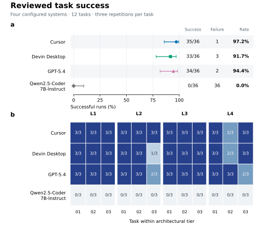

# Tiered System Benchmark (TSB)

TSB tests how well AI coding systems repair web applications, from static websites to applications with a frontend, backend and database. We compare Cursor, Devin Desktop, GPT-5.4 and Qwen2.5-Coder-7B-Instruct on 12 tasks: 144 valid main runs and a separate 72-run Qwen interface experiment.

This repository accompanies *Benchmarking Agentic Code Generation Tools*, a University of Melbourne thesis by Wenrui Chen, supervised by Prof. Richard Sinnott.

[📄 Read the thesis](docs/thesis/benchmarking-agentic-code-generation-tools.pdf) · [📊 Explore results](results/README.md) · [🗃️ Browse the dataset](data/main/README.md) · [🛠️ Setup guide](docs/reproduction.md)

## 🎯 Why this benchmark?

A pass/fail score can hide where a repair went wrong: a tool request may fail, an edit may leave a requirement unmet, or a check may reject a valid solution. In web applications, faults also cross frontend, backend, database and container boundaries.

TSB examines these problems together. Every run starts from a resettable fault and is assessed against a shared task contract. We record tool use and final changes, test a predefined clarification opportunity, and retain both original and reviewed scores. The [thesis, Section 2.7](docs/thesis/benchmarking-agentic-code-generation-tools.pdf) explains the research gap in relation to existing repair benchmarks, agent interfaces and clarification studies.

## ❓ Research questions

| RQ | Question |
|---|---|
| RQ1: Tiered task correctness | How does task success change as debugging tasks progress from static websites to multi-container full-stack applications? |
| RQ2: Clarification-seeking behaviour | When a predefined information gap is present, how often do evaluated systems request the required clarification, and how often do they make unnecessary requests on complete task briefs? |
| RQ3: Comparative system performance | How do Cursor, Devin Desktop, GPT-5.4 and Qwen2.5-Coder-7B-Instruct differ in run-level success, execution time, clarification behaviour and success without evaluator clarification responses on L3/L4 tasks? |

## 🧪 What we built and completed

The completed study includes:

- Twelve task packages with public briefs, faulty repositories, deterministic resets, hidden functional tests, architectural checks and known-good repairs.
- A framework for run preparation, API execution, native-interface recording, evidence validation and final-state assessment.
- Three fresh repetitions per task and system: 12 × 4 × 3 = 144 valid runs, including failures. Pilot data are separate.
- Original and reviewed scores for the same runs, with evidence explaining each correction.
- A 72-run Qwen experiment comparing the frozen fallback with a parser accepting multiline JSON tool requests.
- Run-level data, statistical scripts, notebooks, failure coding and nine quantitative figures in PDF, SVG and PNG formats.

### 🏗️ Four architectural tiers

| Tier | Application | Faults exercised |
|---|---|---|
| L1 | Static website | Asset paths, responsive navigation, client-side validation |
| L2 | FastAPI application | Routing, requirement clarification, persistent storage |
| L3 | Vue + FastAPI | Cross-origin requests, response formats, API endpoint versions |
| L4 | Vue + FastAPI + PostgreSQL | Schema consistency, record creation, database connectivity |

Each tier has three tasks. Success requires normal submission and passage of every applicable functional and architectural check. We also report the proportion of checks passed.

L2-02 contains the predefined information gap, with a fixed authorised clarification response. The other 11 briefs are complete. See the [task catalogue](docs/tasks.md), [protocol](docs/protocol.md) and [analysis plan](benchmark/config/analysis_plan.main.json). For an example, see [L3-03](benchmark/tasks/L3-03).

## 📊 What we found

### ✅ System-level success

Reviewed scoring is the primary analysis; original scores remain available for sensitivity analysis.

| System | Successful runs | Success rate | Original successful runs |
|---|---:|---:|---:|
| Cursor | 35/36 | 97.2% | 30/36 |
| GPT-5.4 | 34/36 | 94.4% | 31/36 |
| Devin Desktop | 33/36 | 91.7% | 31/36 |
| Qwen2.5-Coder-7B-Instruct | 0/36 | 0% | 0/36 |

Task-paired tests across the 12 tasks find differences between each of the first three systems and Qwen after Holm adjustment for six comparisons. Differences among the first three are not statistically significant; that does not establish equivalence. See the [full results](results/README.md) for uncertainty intervals and task-level comparisons.



### 🔎 Findings by research question

- RQ1: Success does not consistently fall as the tiers progress. Cursor, Devin Desktop and GPT-5.4 pass all nine L1 runs each; Their failures involve specific task requirements. Architecture and fault family change together across tiers.
- RQ2: GPT-5.4 requests and receives the authorised clarification in all three L2-02 repetitions. Cursor and Devin Desktop make no requests. Qwen makes eight unauthorised requests across two complete-brief runs.
- RQ3: Median time among successful runs is 27.01 s for GPT-5.4, 102.27 s for Cursor and 209.00 s for Devin Desktop. These times describe each system's successful runs and configured workflow. On L3/L4, each of these three systems succeeds in 17/18 runs without evaluator clarification responses; Qwen succeeds in 0/18. All L3/L4 runs received zero responses, so this metric coincides with success there.

See [secondary outcomes](results/secondary_results.md) for denominators, timing distributions and clarification measures, and [failure analysis](results/failure_analysis.md) for the 42 reviewed unsuccessful runs.

### 🔌 Supplementary Qwen interface control

Qwen makes no final code changes in the main experiment. In the separate 72-run control, both the frozen fallback and the parser accepting physical newlines in JSON achieve 0/36 successes. The relaxed parser accepts more requests, but newly accepted reads still target nonexistent paths. Accepting a request therefore does not ensure that it executes or produces a repair.

[Control results](results/qwen_interface_control.md) · [Control dataset](data/qwen-interface-control/README.md)

## 💬 What the results mean

The failures occur at different points. Qwen fails before producing a repair; the other systems sometimes apply edits that leave task requirements unmet. Recording tool execution and final changes helps distinguish these cases.

Scoring review changes ten success decisions and the ordering of the three higher-success systems. All three remain statistically separated from Qwen under both scoring versions. The [review documentation](docs/evaluation-review.md) explains the corrections.

On L2-02, asking for the missing rule and implementing it are separate outcomes. Recording both shows whether a system used the authorised clarification channel and whether its final submission met the requirement.

The comparison covers complete systems, including their interfaces, tools and execution controls. Architecture and fault family vary together, and one task contains the deliberate information gap. The thesis Discussion considers what these conditions mean for evaluation and future task coverage.

## 🔁 Reproduce the published results

### 📥 1. Get the repository and dependencies

With Python 3.12 and Git installed:

```sh
git clone https://github.com/SmithChen825/tiered-system-benchmark.git
cd tiered-system-benchmark
python -m pip install -r analysis/requirements-statistics.txt
```

### 🧮 2. Validate the data and regenerate analyses

```sh
python analysis/build_dataset.py --check
python analysis/failure_summary.py --check
python analysis/core_success.py
python analysis/secondary_outcomes.py
python analysis/qwen_interface_summary.py
```

These commands run on the published data without model-provider calls. They validate records, regenerate statistical tables and environment manifests, and print the Qwen control summary. You can also use the [core](analysis/core_success.ipynb) and [secondary](analysis/secondary_outcomes.ipynb) notebooks.

### 🖼️ 3. Regenerate the quantitative figures

```sh
python analysis/plot_core_success.py
python analysis/plot_secondary_outcomes.py
```

Outputs go to `results/figures/` as PDF, SVG and 300 dpi PNG files. The [figure map](results/README.md#thesis-figure-map) connects the nine figures to thesis Figures 8 to 16.

### 🧰 4. Check the framework and prepare new experiments

```sh
python -m benchmark.runner.verify_start_commits --verify
python -m unittest benchmark.runner.tests.test_api_wrapper benchmark.runner.tests.test_api_tools benchmark.runner.tests.test_openai_responses_transport benchmark.runner.tests.test_qwen_vllm_transport
```

These offline checks verify task starting states and test the API wrapper. The [setup guide](docs/reproduction.md) and task instructions cover task validation, Chromium, Docker Compose and PostgreSQL.

To run new agent experiments, supply provider access, record native application versions, configure execution and validate a freeze manifest. Account credentials and private operational profiles are excluded from the release. Keep the agent inside its assigned `workspaces/<run_id>/repo` directory, with hidden tests and known-good repairs outside its information boundary.

## 🗂️ Data and repository guide

| Location | Contents |
|---|---|
| [docs/thesis/](docs/thesis/README.md) | Final thesis PDF supplied as `thesisRevised36.pdf`, with version information |
| [benchmark/tasks/](benchmark/tasks) | Twelve briefs, fixtures, evaluators, repairs and validation instructions |
| [benchmark/runner/](benchmark/runner) | Run preparation, execution, recording and framework tests |
| [benchmark/config/](benchmark/config) | Task set, schedule, limits and analysis specifications |
| [data/main/](data/main/README.md) | Unified 144-run dataset and field guide |
| [data/L1/](data/L1/README.md), [L2/](data/L2/README.md), [L3/](data/L3/README.md), [L4/](data/L4/README.md) | Tier-specific checks, diffs and attempt records |
| [data/evaluation-review/](data/evaluation-review) | Paired scoring versions and review evidence |
| [data/qwen-interface-control/](data/qwen-interface-control/README.md) | Separate 72-run supplementary experiment |
| [data/pilot/](data/pilot) | Sixteen selected pilot runs and 27 retained attempts, excluded from main comparisons |
| [analysis/](analysis) | Dataset construction, statistics, plotting and notebooks |
| [results/](results/README.md) | Figures, tables, failure coding and analysis manifests |

The [release scope](docs/release-scope.md) describes the published evidence and archival boundaries. Full runtime archives and internal handoff notes remain outside the release.

## 📚 Reference and questions

When referring to this work, identify the thesis and the repository commit used:

> Chen, Wenrui. (2026). *Benchmarking Agentic Code Generation Tools*. University of Melbourne. Supervisor: Prof. Richard Sinnott.

Use [GitHub Issues](https://github.com/SmithChen825/tiered-system-benchmark/issues) for questions about tasks, data or reproduction, including the task/run identifier and relevant command output where applicable.
